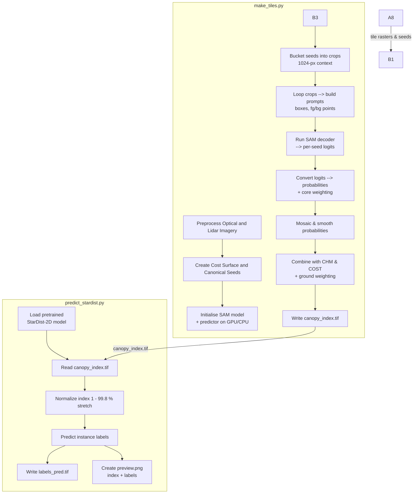

# sam

Note: Manuscript-related code, figures, notebooks, and results have moved to `manuscript/`. See `manuscript/README.md` for details and usage.

## Setup

### Create Conda Env and Install Dependencies

```bash
conda env create -f environment-wsl.yml -n sam_star
conda activate sam_star
```

## Step 1: Create tiles

```bash
python make_tiles.py --img image.tif --chm chm.tif --den density.tif 
```

## Step 2: Create Predictions Maps

```bash
# process everything (unchanged behaviour)
./run_predict_tiles.sh

# process only a few specific tiles
./run_predict_tiles.sh tile_000_001 tile_000_002
```

## Step 3: Create Crown Polygons


## Methods




### 1. Local peak detection (lidar derived surfaces)

Concept

Smooth the raster a little, find local peaks that are at least _d\_min_ meters tall or have at least _d\_min_ point density, and keep only one peak within a _min\_dist\_px_ pixel neighborhood.

Equations
	
1. Gaussian smoothing (optional):

$$
R_\sigma(x,y)=\bigl(R \;*\;\mathcal{G}_\sigma\bigr)(x,y)
$$

where R is the original raster and $\mathcal{G}_\sigma$ is a 2‑D Gaussian of standard deviation $\sigma$.

2. Local‑maximum test:

For every pixel $(i,j)$ define a square neighborhood:

$$
\mathcal N_{i,j}=\{(u,v)\;|\;\lvert u-i\rvert\le m,\; \lvert v-j\rvert\le m\},\quad m=\texttt{min_dist_px}
$$

Mark a peak when:

$$
R_\sigma(i,j)=\max_{(u,v)\in \mathcal N_{i,j}}R_\sigma(u,v)
\quad\text{and}\quad
R_\sigma(i,j)\ge d_{\min}.
$$

3. Convert to map coordinates: pixel row/column → x,y using the raster transform.

Each peak is stored with its height h and a tag origin ∈ {“chm”, “den”}.


### 2. Height‑aware ε-neighbour clustering (first pass)

Concept

Near‑by peaks of similar height are grouped so we can later keep just one “canonical” seed per group.

Equations

For each unassigned peak $p_i$ with height $h_i$:

1. Neighbourhood radius (depends on height):

$$
\varepsilon_i=\operatorname{clip}\bigl(\alpha h_i,\,
\varepsilon_{\min},\,\varepsilon_{\max}\bigr),
$$

where $\alpha=\texttt{eps\_scale}$.

2. Candidate set:

$$
\mathcal P_i=\{p_j\;:\;\|p_j-p_i\|_2\le \varepsilon_i\}.
$$

3. Reject if vertical spread is large:

If

$$
\max_{j\in\mathcal P_i}h_j-\min_{j\in\mathcal P_i}h_j>\Delta z_{\text{th}}\;(\texttt{z\_thresh}),
$$

the group is ignored.

4. Form a cluster if |\mathcal P_i|\ge \texttt{min\_samples}; assign all its members the same temporary label.

(This is a very small DBSCAN executed “manually” point‑by‑point.)


### 3. Cost‑aware distance graph

Concept

Build a sparse distance matrix in which the straight‑line distance between two peaks is lengthened in proportion to the mean cost along the line connecting them.  This makes seeds separated by high‑cost canopy gaps effectively farther apart.

Equations

For two peaks p_i=(x_i,y_i) and p_j=(x_j,y_j)
	1.	Euclidean distance:
d_{ij}^{\;\mathrm{xy}}=\sqrt{(x_j-x_i)^2+(y_j-y_i)^2}.
	2.	Sample the cost raster along the straight line: take N equally spaced points
(x(t_k),y(t_k))=(1-t_k)p_i+t_k p_j,\quad
t_k=\frac{k}{N+1},\;k=1,\dots,N.
	3.	Mean cost on the line:
\bar C_{ij}=\frac1N\sum_{k=1}^N C\!\bigl(x(t_k),y(t_k)\bigr).
	4.	Effective distance:
d_{ij}=
\begin{cases}
d_{ij}^{\;\mathrm{xy}}, & d_{ij}^{\;\mathrm{xy}}\le d_{\text{xy‑thr}}\\[4pt]
d_{ij}^{\;\mathrm{xy}}\Bigl(1+w_c\,\bar C_{ij}\Bigr), & \text{otherwise}
\end{cases}
where w_c=\texttt{cost\_weight}.
	5.	Edge criterion: add an undirected edge (i,j) with weight d_{ij} iff d_{ij}\le d_{\text{merge}}.

The result is a sparse symmetric matrix D.

⸻

4 DBSCAN on the cost graph (second pass)

Run standard DBSCAN with:
	•	distance matrix D (metric = “pre‑computed”);
	•	\varepsilon=d_{\text{merge}};
	•	min_samples = 1.

Seeds connected by any sequence of low‑cost edges fall in the same cluster.

⸻

5 Optional vertical split inside a cluster

If a cluster’s height range exceeds dz_merge, it is cut into “low” and “high” sub‑clusters at the median height.

⸻

6 Canonical seed per cluster

For each final cluster C:
	•	Planar centre:
\bigl(\bar x_C,\bar y_C\bigr)=\frac1{|C|}\sum_{i\in C}(x_i,y_i).
	•	Representative height:
h_C=\max_{i\in C}h_i.

Return the point (\bar x_C,\bar y_C) with attribute height = h_C.
These points form the GeoPackage seeds.gpkg used later by the watershed / SAM workflow.

⸻

In one sentence

Peaks are detected on CHM and density rasters, grouped by proximity and similar height, merged again using distances inflated by canopy‑gap cost, optionally split by tall/short strata, and finally replaced with the geometric centre of each group—yielding exactly one robust seed per potential tree crown.
