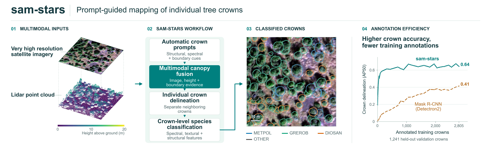

# samstars

[](https://pypi.org/project/samstars/)
[](https://pypi.org/project/samstars/)
[](https://github.com/iosefa/samstars/actions/workflows/ci.yml)
[](https://samstars.sefa.ai/)
[](https://github.com/iosefa/samstars/graphs/contributors)
[](https://pepy.tech/projects/samstars)
[](LICENSE)

`samstars` is a Python library for instance segmentation of individual trees
using high-resolution imagery and lidar-derived rasters.



Read the full documentation at [samstars.sefa.ai](https://samstars.sefa.ai).

## Installation

Install from PyPI with Python 3.10–3.12:

```bash
python -m pip install samstars
```

See the [installation guide](https://samstars.sefa.ai/installation/) for
supported platforms and optional GPU setup.

## Developer setup

From a local clone:

```bash
python -m pip install -e .
```

To run the tests:

```bash
python -m pip install -e ".[test]"
python -m pytest
```

For documentation development:

```bash
python -m pip install -e ".[docs]"
mkdocs serve
```

Conda setup is covered in the
[installation guide](docs/installation.md#conda-development-environments).
